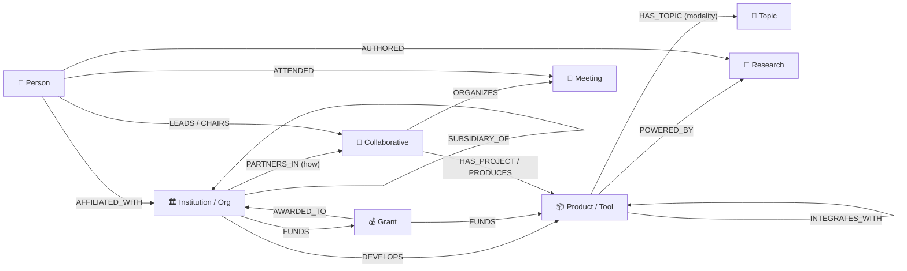
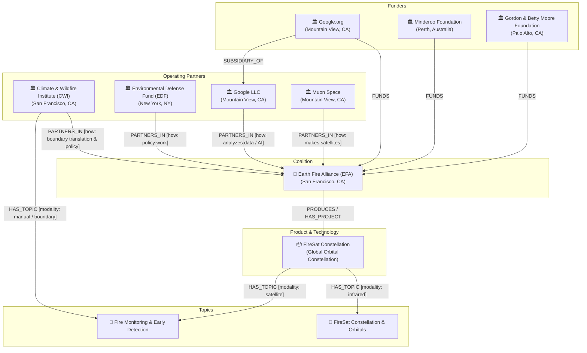

# Domain Ontology & Data Model Specification
## Project: GraphEmber
**Location**: `c:\Users\David\Projects\GraphEmber\ai-memory\01_DOMAIN_ONTOLOGY_AND_DATA_MODEL.md`  
**Reference Code**: [`src/types/graph.ts`](file:///c:/Users/David/Projects/GraphEmber/src/types/graph.ts), [`src/data/initialData.ts`](file:///c:/Users/David/Projects/GraphEmber/src/data/initialData.ts)

---

## 1. Executive Summary & Genesis

GraphEmber was originally planned as an 8-entity network visualization platform. During development on October 16, 2026, David provided an authoritative architectural blueprint derived from **"Firelines"**—a specialized wildfire intelligence graph database.

### The Fundamental Definition
> **Ontology**: *"The blueprint that defines entities (boxes) in a graph, their relationships (the arrows linking entities), and their properties (metadata about entities and/or relationships)."*

The core architectural paradigm of Firelines defines a 4-tier backbone:
$$\text{[ Organization ]} \xrightarrow[\text{how}]{\text{PartnersIn}} \text{[ Consortium ]} \xrightarrow{\text{Produces / HasProject}} \text{[ Product ]} \xrightarrow[\text{modality}]{\text{HasTopic}} \text{[ Topic ]}$$

This transformed GraphEmber in two fundamental ways:
1. **Edge-Level Semantic Attributes**: Relationships are not merely named directed edges; they carry operational attributes (`how`, `modality`, and arbitrary `properties`).
2. **Elevation of Topic to First-Class Entity**: Rather than flattening subject tags into string arrays on individual nodes, high-level challenges and missions (e.g., *Fire Monitoring*, *Home Hardening*, *Smoke Retrieval*) exist as dedicated nodes (`topic`), allowing multiple tools and institutions to cluster around shared objectives across varying operational modalities.

---

## 2. The 9 First-Class Entity Types

Every node in GraphEmber extends the `BaseNode` interface and belongs to one of nine distinct entity types. Each type possesses a tailored visual token, hex color, icon, and schema:

| Entity Type | Visual Token | Hex Code | Icon | Purpose & Description | Key Attributes |
|:---|:---|:---:|:---:|:---|:---|
| **`person`** | Emerald | `#10b981` | 👤 | Researchers, Principal Investigators (PIs), Fellows, Directors, Policy Champions. | `title`, `role`, `primaryAffiliationId`, `email`, `bio`, `researchInterests` |
| **`institution`** | Amber / Gold | `#f59e0b` | 🏛️ | Universities, Research Centers, Federal/State Agencies, NGOs, Tech Companies. | `acronym`, `institutionType`, `location`, `website` |
| **`collaborative`** | Flame Tangerine | `#f97316` | 🤝 | Multi-institutional alliances, consortia, public-private partnerships, coalitions. | `acronym`, `mission`, `leadInstitutionId`, `governanceModel`, `focusAreas` |
| **`program`** | Sapphire | `#3b82f6` | 🚀 | Academic labs, funded thematic initiatives, operational task forces. | `domain`, `leadInstitutionId`, `launchYear`, `status` |
| **`product`** | Indigo | `#6366f1` | 📦 | Software libraries, web platforms, APIs, ML models, hardware, satellite projects. | `productType`, `version`, `license`, `repositoryUrl`, `documentationUrl`, `status` |
| **`grant`** | Ruby Coral | `#ef4444` | 💰 | Philanthropic gifts, cooperative agreements, competitive research awards. | `grantNumber`, `funderInstitutionId`, `recipientInstitutionId`, `amount`, `startDate`, `endDate` |
| **`research`** | Amethyst | `#a855f7` | 📄 | Peer-reviewed publications, open datasets, algorithmic white papers, models. | `researchType`, `year`, `doiUrl`, `venue`, `abstract` |
| **`meeting`** | Cyan Sky | `#06b6d4` | 📅 | Symposia, technical working groups, field reviews, annual convenings. | `meetingType`, `date`, `location`, `virtual`, `summary`, `outcomes` |
| **`topic`** | Crimson Rose | `#e11d48` | 🎯 | Thematic problem domains, research frontiers, operational disciplines. | `domain`, `modalities`, `scope` |

---

## 3. Relationship Taxonomy (27 Relation Types)

GraphEmber supports 27 directed, typed relationships. The table below outlines the primary valid entity combinations and semantic roles:



### Complete Relationship Reference

1. **`PARTNERS_IN`**: Connects an `institution` to a `collaborative`. Carries `how` (e.g., `how: "makes satellites"`).
2. **`HAS_PROJECT` / `PRODUCES`**: Connects a `collaborative` or `program` to a `product` (e.g., EFA $\rightarrow$ FireSat).
3. **`HAS_TOPIC`**: Connects an entity (`product`, `institution`, `research`) to a `topic`. Carries `modality` (e.g., `modality: "satellite"` or `modality: "manual"`).
4. **`SUBSIDIARY_OF`**: Hierarchical organizational relationship (e.g., Google.org $\rightarrow$ Google).
5. **`INVOLVED_IN`**: General organizational participation in programs or initiatives.
6. **`FUNDS`**: Grantmaker or philanthropist providing capital to an entity or grant.
7. **`AWARDED_TO`**: Grant award assigned to an institution or PI.
8. **`AFFILIATED_WITH`**: Individual person linked to their primary or secondary institution.
9. **`LEADS` / `CHAIRS`**: Leadership or steering role in a program or collaborative.
10. **`CO_INVESTIGATOR`**: Co-PI on a grant or collaborative project.
11. **`AUTHORED`**: Researcher authorship on publications, datasets, or code models.
12. **`HOSTS`**: Physical or administrative hosting of a program or lab.
13. **`DEVELOPS`**: Engineering or scientific construction of a software library or tool.
14. **`POWERS`**: Core algorithm or engine driving a broader user-facing platform.
15. **`INTEGRATES_WITH`**: Interoperability between two software systems or APIs.
16. **`DEPLOYED_IN`**: Operational deployment of a tool into an agency workflow (e.g., Pyregence into CAL FIRE).
17. **`ATTENDED`**: Participation of an individual in a symposium or working group.
18. **`ORGANIZES`**: Institutional sponsorship or staging of an event.
19. **`MEMBER_OF`**: Formal institutional membership in an alliance.
20. **`COLLABORATES_WITH`**: Peer-to-peer collaboration between researchers.
21. **`STEERS`**: Governance board direction over strategic roadmap.
22. **`RELATED_TO`**: General associative tie.
23. **`OPERATES`**: Day-to-day administration and maintenance of infrastructure.
24. **`ADMINISTERS`**: Fiduciary or grant oversight.

---

## 4. Edge Semantic Attributes

Unlike conventional graphs that only store `source`, `target`, and `type`, GraphEmber implements:

```typescript
export interface GraphEdge {
  id: string;
  source: string | GraphNode;
  target: string | GraphNode;
  type: RelationType;
  label?: string;
  weight?: number;
  description?: string;
  how?: string;        // Explicit operational role (e.g. "makes satellites", "policy work")
  modality?: string;   // Technical execution medium (e.g. "satellite", "ground-sensor")
  properties?: Record<string, any>;
  startDate?: string;
  endDate?: string;
}
```

### Visual & Interactive Rendering of Attributes
* **In Canvas**: When an edge is focused or its incident nodes are hovered, the canvas engine draws a dynamic text badge pill directly over the curve center:
  * For `PARTNERS_IN`: renders `PartnersIn (makes satellites)`.
  * For `HAS_TOPIC`: renders `HasTopic [modality: satellite]`.
* **In Dossier Drawer**: The "Connected Network" panel renders explicit badge chips with emerald text for `how` and flame amber text for `modality`.

---

## 5. Ground-Truth Case Study: Earth Fire Alliance (EFA) & FireSat

The reference testbed implemented in `src/data/initialData.ts` mirrors the real-world Earth Fire Alliance network:



### Entity Records in `initialData.ts`:
1. **`efa-consortium`**: Earth Fire Alliance (`type: collaborative`, governance: Consortium, location: San Francisco, CA).
2. **`inst-muon-space`**: Muon Space (`type: institution`, type: Private Sector, location: Mountain View, CA).
3. **`inst-google-org`**: Google.org (`type: institution`, type: NGO / Philanthropic).
4. **`inst-google`**: Google LLC (`type: institution`, type: Private Sector).
5. **`inst-moore-foundation`**: Gordon and Betty Moore Foundation (`type: institution`, location: Palo Alto, CA).
6. **`inst-minderoo`**: Minderoo Foundation (`type: institution`, location: Australia).
7. **`inst-edf`**: Environmental Defense Fund (`type: institution`, location: New York, NY).
8. **`inst-cwi`**: Climate & Wildfire Institute (`type: institution`, location: San Francisco, CA).
9. **`prod-firesat`**: FireSat Constellation (`type: product`, productType: Project / Hardware).
10. **`topic-fire-monitoring`**: Fire Monitoring & Early Detection (`type: topic`, domain: Remote Sensing & Spaceborne Observation).
11. **`topic-firesat`**: FireSat Constellation & Orbitals (`type: topic`, domain: Spaceborne Remote Sensing).

---

## 6. TypeScript Interface Contracts

The full data contracts are defined in [`src/types/graph.ts`](file:///c:/Users/David/Projects/GraphEmber/src/types/graph.ts):

```typescript
export interface TopicNode extends BaseNode {
  type: 'topic';
  domain?: string;
  modalities?: string[];
  scope?: string;
}

export interface NetworkDataset {
  metadata: {
    title: string;
    version: string;
    description: string;
    lastUpdated: string;
  };
  nodes: GraphNode[];
  edges: GraphEdge[];
}
```

Incoming agents extending the schema must ensure all new entities implement `BaseNode` and are registered in `NodeType` and `GraphNode`.
