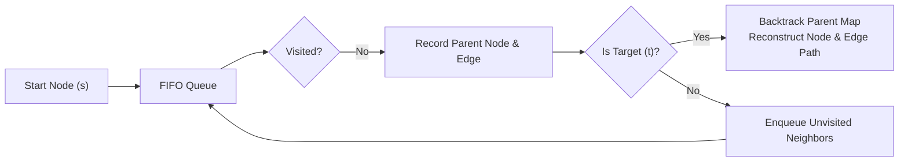

# Methods, Algorithms & Technical Architecture
## Project: GraphEmber
**Location**: `c:\Users\David\Projects\GraphEmber\ai-memory\02_METHODS_ALGORITHMS_AND_TECHNICAL_ARCHITECTURE.md`  
**Reference Code**: [`src/utils/graphMetrics.ts`](file:///c:/Users/David/Projects/GraphEmber/src/utils/graphMetrics.ts), [`src/components/NetworkCanvas.tsx`](file:///c:/Users/David/Projects/GraphEmber/src/components/NetworkCanvas.tsx), [`src/App.tsx`](file:///c:/Users/David/Projects/GraphEmber/src/App.tsx)

---

## 1. Graph Analytics & Mathematical Methods

GraphEmber implements dedicated graph theoretical algorithms in [`src/utils/graphMetrics.ts`](file:///c:/Users/David/Projects/GraphEmber/src/utils/graphMetrics.ts) to provide network intelligence, bridge detection, and navigation.

### A. Degree Centrality & Directed Flow Accounting

For a directed property graph $G = (V, E)$, degree metrics are computed in $O(|V| + |E|)$ time:

$$\text{inDegree}(v) = \sum_{e \in E} \mathbb{I}(\text{target}(e) = v)$$
$$\text{outDegree}(v) = \sum_{e \in E} \mathbb{I}(\text{source}(e) = v)$$
$$\text{degree}(v) = \text{inDegree}(v) + \text{outDegree}(v)$$

```typescript
export function calculateNodeMetrics(nodes: GraphNode[], edges: GraphEdge[]): Map<string, NodeMetrics> {
  const metricsMap = new Map<string, NodeMetrics>();
  nodes.forEach((n) => metricsMap.set(n.id, { degree: 0, inDegree: 0, outDegree: 0 }));

  edges.forEach((edge) => {
    const s = typeof edge.source === 'object' ? edge.source.id : edge.source;
    const t = typeof edge.target === 'object' ? edge.target.id : edge.target;

    const sm = metricsMap.get(s);
    if (sm) { sm.outDegree += 1; sm.degree += 1; }
    const tm = metricsMap.get(t);
    if (tm) { tm.inDegree += 1; tm.degree += 1; }
  });
  return metricsMap;
}
```

* **Centrality Ranking**: Surfaces the most connected hubs, institutional bridges, and pivotal programs in [`src/components/MetricsModal.tsx`](file:///c:/Users/David/Projects/GraphEmber/src/components/MetricsModal.tsx).

---

### B. Shortest Path Finder Algorithm (Breadth-First Search)

To calculate degrees of separation and identify cross-institutional linkages (e.g., *"How does Dr. Marcus Ramirez connect to NASA Applied Sciences?"*), GraphEmber uses an unweighted Breadth-First Search (BFS) with dual parent tracking (`parentNode` and `parentEdge`):



#### Algorithm Implementation
```typescript
export function findShortestPath(
  nodes: GraphNode[],
  edges: GraphEdge[],
  startNodeId: string,
  endNodeId: string
): { pathNodeIds: string[]; pathEdgeIds: string[] } | null {
  if (startNodeId === endNodeId) return { pathNodeIds: [startNodeId], pathEdgeIds: [] };

  // 1. Build bidirectional adjacency list
  const adj = new Map<string, Array<{ neighborId: string; edgeId: string }>>();
  nodes.forEach((n) => adj.set(n.id, []));
  edges.forEach((e) => {
    const s = typeof e.source === 'object' ? e.source.id : e.source;
    const t = typeof e.target === 'object' ? e.target.id : e.target;
    adj.get(s)?.push({ neighborId: t, edgeId: e.id });
    adj.get(t)?.push({ neighborId: s, edgeId: e.id });
  });

  // 2. BFS Traversal
  const queue: string[] = [startNodeId];
  const visited = new Set<string>([startNodeId]);
  const parentNode = new Map<string, string>();
  const parentEdge = new Map<string, string>();

  while (queue.length > 0) {
    const current = queue.shift()!;
    if (current === endNodeId) {
      // 3. Backtrack path reconstruction
      const pathNodes: string[] = [];
      const pathEdges: string[] = [];
      let curr = endNodeId;
      while (curr !== startNodeId) {
        pathNodes.unshift(curr);
        const edge = parentEdge.get(curr);
        if (edge) pathEdges.unshift(edge);
        curr = parentNode.get(curr)!;
      }
      pathNodes.unshift(startNodeId);
      return { pathNodeIds: pathNodes, pathEdgeIds: pathEdges };
    }

    const neighbors = adj.get(current) || [];
    for (const { neighborId, edgeId } of neighbors) {
      if (!visited.has(neighborId)) {
        visited.add(neighborId);
        parentNode.set(neighborId, current);
        parentEdge.set(neighborId, edgeId);
        queue.push(neighborId);
      }
    }
  }
  return null;
}
```

---

### C. Neighborhood Isolation & Expansion (1-Hop / 2-Hop)

To eliminate visual clutter in dense networks (180+ nodes), GraphEmber implements level-order neighborhood expansion:
* **1-Hop Neighborhood**: Direct immediate collaborators, funders, and topics.
* **2-Hop Neighborhood**: Extended ecosystem context (collaborators of collaborators).

```typescript
export function getNeighborhood(
  nodeId: string,
  edges: GraphEdge[],
  hops: 1 | 2 = 1
): { nodeIds: Set<string>; edgeIds: Set<string> } {
  const nodeIds = new Set<string>([nodeId]);
  const edgeIds = new Set<string>();
  let currentLevel = new Set<string>([nodeId]);

  for (let h = 0; h < hops; h++) {
    const nextLevel = new Set<string>();
    edges.forEach((e) => {
      const s = typeof e.source === 'object' ? e.source.id : e.source;
      const t = typeof e.target === 'object' ? e.target.id : e.target;
      if (currentLevel.has(s)) {
        nodeIds.add(t);
        edgeIds.add(e.id);
        nextLevel.add(t);
      }
      if (currentLevel.has(t)) {
        nodeIds.add(s);
        edgeIds.add(e.id);
        nextLevel.add(s);
      }
    });
    currentLevel = nextLevel;
  }
  return { nodeIds, edgeIds };
}
```

* **Visual Dimming**: Non-neighborhood nodes have their global opacity lowered to `0.15` and labels dimmed, cleanly isolating the active sub-graph in the canvas.

---

## 2. D3 Physics Simulation Engine

The layout is computed dynamically in [`src/components/NetworkCanvas.tsx`](file:///c:/Users/David/Projects/GraphEmber/src/components/NetworkCanvas.tsx) using `d3-force`.

### Configured Forces & Parameters:

| Force Name | D3 Implementation | Parameters & Tuning | Purpose |
|:---|:---|:---|:---|
| **Link Force** | `d3.forceLink(edges)` | `distance: 110`, `strength: 0.35` | Maintains spring tension between connected nodes. |
| **Charge Repulsion** | `d3.forceManyBody()` | `strength: -380`, `distanceMax: 600` | Simulates electrostatic repulsion to spread clusters evenly. |
| **Centering Force** | `d3.forceCenter(w/2, h/2)`| `strength: 0.05` | Gently draws free-floating components toward the center. |
| **Collision Force** | `d3.forceCollide()` | `radius: getNodeRadius(d) + 16`, `strength: 0.8` | Prevents node overlap and label collisions. |
| **Alpha Decay** | `simulation.alphaDecay()` | `0.022` | Controls cooldown rate; prevents frantic oscillations. |
| **Velocity Decay** | `simulation.velocityDecay()`| `0.35` | Simulates friction/damping in movement. |

### Dynamic Node Sizing Method:
```typescript
const getNodeRadius = (node: GraphNode): number => {
  switch (node.type) {
    case 'institution':
    case 'collaborative':
      return 28; // Major structural pillars
    case 'program':
    case 'product':
    case 'grant':
    case 'topic':
      return 24; // Core operational assets and topics
    case 'person':
      return 22; // Individual actors
    case 'research':
    case 'meeting':
    default:
      return 19; // Events and artifacts
  }
};
```

---

## 3. High-Performance HTML5 Canvas Rendering Engine

GraphEmber renders via an HTML5 2D Canvas context rather than SVG DOM elements. This guarantees continuous 60fps interaction even with hundreds of nodes and complex halo glow effects.

### A. Retina / High-DPI Display Scaling
```typescript
const dpr = window.devicePixelRatio || 1;
canvas.width = width * dpr;
canvas.height = height * dpr;
canvas.style.width = `${width}px`;
canvas.style.height = `${height}px`;
ctx.scale(dpr, dpr);
```

### B. Viewport Coordinate Transformations & Zoom/Pan
D3 Zoom (`d3.zoom()`) maintains an affine transformation vector $[k, x, y]$:
```typescript
ctx.save();
ctx.translate(transform.x, transform.y);
ctx.scale(transform.k, transform.k);
// Render nodes, edges, labels in graph space
ctx.restore();
```

To map mouse clicks to graph entities, mouse screen coordinates are unprojected:
```typescript
const [graphX, graphY] = transformRef.current.invert([clientX - rect.left, clientY - rect.top]);
```

### C. Quadratic Bezier Curved Directed Edges
To avoid straight-line edge collisions and clearly depict directional flow, edges are rendered with a calculated lateral curve:
$$\vec{M} = \frac{\vec{S} + \vec{T}}{2} + \vec{N}_{\perp} \cdot \delta$$
Where $\vec{N}_{\perp}$ is the unit normal vector perpendicular to the source-target line.

* **Arrowhead Math**:
  $$\theta = \text{atan2}(t_y - c_y, t_x - c_x)$$
  The arrowhead tip is recessed by the target node's radius so it terminates cleanly on the node's perimeter without being obscured.

### D. Edge Annotation Text Badges
For focused edges, the midpoint $\vec{M}$ is transformed into an oriented badge:
1. Calculates tangent angle $\alpha = \text{atan2}(t_y - s_y, t_x - s_x)$ (normalized to keep text right-side up).
2. Renders a dark glassmorphic rounded rectangle (`#0f172ae0` with border).
3. Prints crisp monospace text: `PartnersIn (makes satellites)` or `HasTopic [modality: satellite]`.

---

## 4. UI Architecture & React 19 Component Hierarchy

```mermaid
graph TD
    App["src/App.tsx<br/>(Master State: nodes, edges, selection, filters, paths)"]
    
    Header["src/components/Header.tsx<br/>(CWI Brand Lockup, Global Metrics, Omnibox Search)"]
    FilterBar["src/components/FilterBar.tsx<br/>(Type Toggles, Tag Chips, Funding Threshold Slider)"]
    Canvas["src/components/NetworkCanvas.tsx<br/>(Canvas Engine, D3 Physics, Zoom Controls)"]
    Dossier["src/components/DossierDrawer.tsx<br/>(Slide-out Entity Dossier, 1-Click Graph Traversal)"]
    
    OntologyModal["src/components/OntologyModal.tsx<br/>(Firelines Blueprint, EFA Flow, Canvas Focus)"]
    CwiModal["src/components/CwiBrandModal.tsx<br/>(CWI Institutional Overview, Fund Highlights)"]
    PathModal["src/components/PathFinderModal.tsx<br/>(BFS Traversal Selector, Path Display)"]
    MetricsModal["src/components/MetricsModal.tsx<br/>(Centrality Rankings, Ecosystem Funding)"]
    AddModal["src/components/AddEntityModal.tsx<br/>(Form to Create Nodes & Edges dynamically)"]

    App --> Header
    App --> FilterBar
    App --> Canvas
    App --> Dossier
    App --> OntologyModal
    App --> CwiModal
    App --> PathModal
    App --> MetricsModal
    App --> AddModal
```



### Multi-Predicate Filter Engine
In `App.tsx`, active nodes are dynamically filtered using a combined predicate:
```typescript
const filteredNodes = useMemo(() => {
  return dataset.nodes.filter((node) => {
    // 1. Entity Type Check
    if (!filterState.activeTypes.has(node.type)) return false;

    // 2. Text Search Match
    if (filterState.searchQuery) {
      const q = filterState.searchQuery.toLowerCase();
      const matchLabel = node.label.toLowerCase().includes(q);
      const matchDesc = node.description?.toLowerCase().includes(q) || false;
      const matchTags = node.tags?.some((t) => t.toLowerCase().includes(q)) || false;
      if (!matchLabel && !matchDesc && !matchTags) return false;
    }

    // 3. Thematic Tag Intersection
    if (filterState.selectedTags.size > 0) {
      const hasTag = node.tags?.some((t) => filterState.selectedTags.has(t));
      if (!hasTag) return false;
    }

    // 4. Funding Threshold (for Grant Nodes)
    if (node.type === 'grant') {
      const g = node as GrantNode;
      if (g.amount && g.amount < filterState.minFundingAmount) return false;
    }

    return true;
  });
}, [dataset.nodes, filterState]);
```
Edges whose source or target nodes are filtered out are automatically suppressed.
