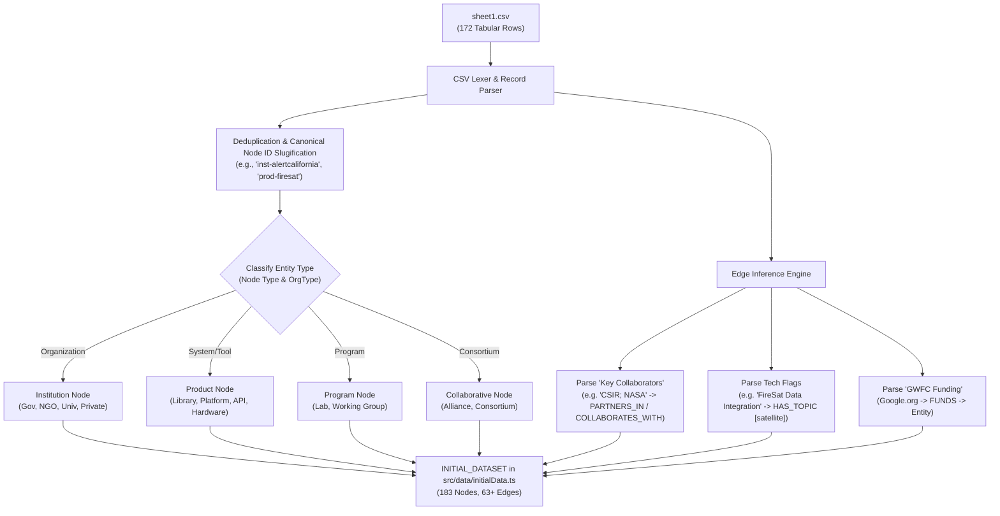

# Data Pipeline & Sheets Ingestion Protocol
## Project: GraphEmber
**Location**: `c:\Users\David\Projects\GraphEmber\ai-memory\03_DATA_PIPELINE_AND_SHEETS_INGESTION.md`  
**Reference Code**: [`sheet1.csv`](file:///c:/Users/David/Projects/GraphEmber/sheet1.csv), [`sheet2.csv`](file:///c:/Users/David/Projects/GraphEmber/sheet2.csv), [`src/data/initialData.ts`](file:///c:/Users/David/Projects/GraphEmber/src/data/initialData.ts)

---

## 1. Executive Summary & Google Sheets Overview

GraphEmber's dataset is anchored in real-world wildfire intelligence initiatives provided via Google Sheets by David during development:

1. **Sheet 1**: **AI Wildfire Landscape Data**  
   * **URL**: [`https://docs.google.com/spreadsheets/d/1bw2XNGHbQXSmz2UCveUSq8TLgGJGXpnUIrjVmOCIOvE/edit`](https://docs.google.com/spreadsheets/d/1bw2XNGHbQXSmz2UCveUSq8TLgGJGXpnUIrjVmOCIOvE/edit)  
   * **Status**: **Fully Ingested** (172 landscape entities, 183 total nodes, 63+ edges).
   * **Local Raw Dump**: [`sheet1.csv`](file:///c:/Users/David/Projects/GraphEmber/sheet1.csv) (46.5 KB).

2. **Sheet 2**: **Supplemental Registry & Ecosystem Data**  
   * **URL**: [`https://docs.google.com/spreadsheets/d/16byGxXobEVl8YKtmImO7UMR-95ZsmLYFjY7qjSyY_LY/edit?gid=0#gid=0`](https://docs.google.com/spreadsheets/d/16byGxXobEVl8YKtmImO7UMR-95ZsmLYFjY7qjSyY_LY/edit?gid=0#gid=0)  
   * **Status**: **Pending Public Sharing Access** (returns HTTP 302 Google Accounts sign-in challenge).
   * **Local Raw Dump**: [`sheet2.csv`](file:///c:/Users/David/Projects/GraphEmber/sheet2.csv) and [`sheet2_new.csv`](file:///c:/Users/David/Projects/GraphEmber/sheet2_new.csv) (9.1 KB HTML login response).

---

## 2. Forensic Analysis of Sheet 1 (AI Wildfire Landscape Data)

Sheet 1 contains 172 structured rows and 40 columns classifying global entities working across wildfire intelligence, Earth observation, data platforms, and policy.

### Complete Column Schema & Field Mapping:

| Col # | Column Header in Sheet 1 | GraphEmber Property Mapping | Description & Values |
|:---:|:---|:---|:---|
| `0` | `NodeID` | `node.properties.sheetNodeId` | Numeric identifier (1 to 172). |
| `1` | `Label` | `node.label` | Official entity or tool name. |
| `2` | `Link` | `node.website` | Direct URL to organization homepage or project portal. |
| `3` | `Node Type` | `node.type` | `Organization` $\to$ `institution`; `System/Tool/Program` $\to$ `product`/`program`; `Consortium` $\to$ `collaborative`. |
| `4` | `OrgType` | `institution.institutionType` | `Government`, `Nonprofit`, `Philanthropic`, `Startup / Private`, `University / Academic`, `Utility / telecommunication`. |
| `5` | `GWFC Funding` | `node.properties.gwfcFunded` | `Y` or `N` (Google.org Wildfire Commons funded flag). |
| `6` | `GWFC Funding Link` | `node.properties.gwfcLink` | Direct grant announcement or project URL. |
| `7` | `RR: ResearchReport` | `node.properties.researchReport` | Presence in foundational research report. |
| `8` | `Location` | `node.location` | City, State, Country, or `Global`. |
| `9` | `RR Partner Function` | `node.properties.partnerFunction` | e.g., `Co-Funding`, `Primary Research`, `Technical`. |
| `10` | `AI Collaborative Charter?` | `node.properties.charterSignatory`| Signatory status of the AI Collaborative Charter. |
| `11` | `GCD: CollabDesign` | `node.tags` | Inclusion in Global Collaborative Design. |
| `12` | `GCD Type` | `collaborative.governanceModel` | e.g., `Delivery Support`, `Steering Group`. |
| `13` | `Collaborative Role` | `node.role` | `Industry`, `Program Funders`, `Other Partners`, `Advisors`. |
| `14` | `GDC Primary Delivery Role Class` | `node.tags` | e.g., `Telecommunication`, `Practitioners`, `Domain Experts`. |
| `16` | `Fire Phase Pre` | `node.tags` | Operational wildfire phases: `Pre`, `Active`, `Post`, `All`. |
| `17` | `Key Collaborators` | Edge synthesis (`PARTNERS_IN`, etc.) | Semicolon-delimited list of collaborator entities. |
| `18` | `Key Deliverables` | `node.description` | Core capability (e.g., "Real-time fire alerts", "Wildfire management projects"). |
| `19` | `Stages` | `node.tags` | Operational stages (e.g., `Detect + Validate`, `All Stages`). |
| `20` | `Geographic Context` | `node.location` | Operational focus (e.g., `Africa`, `Developing Countries`, `Global`). |
| `21` | `Technology Ecosystem` | `node.tags` | Broad tech category. |
| `22-31` | Specialized Technical Flags | Topic synthesis (`HAS_TOPIC`) | Columns: `FireSat Data Integration`, `Integrated Fire Management Tools`, `Remote Sensing Tech Development and Application`, `Retrieval Development`, `Mapping Wildfire Risk`, `Wildfire Spread Modeling`, `Data Stores`, `ESDTs`, `End-User Applications`, `Remote Sensing Tech`. |
| `33-38` | Strategic Objective Pillars | `node.tags` | `1. Creating data, technology, & AI solutions that accelerate action`, `2. Enabling faster, more precise data-driven decision making`, `3. Enabling environment`, `Convening organizations`. |

---

## 3. The Tabular-to-Graph ETL Pipeline

The transformation from flat tabular CSV rows to GraphEmber's rich property graph follows a deterministic multi-stage pipeline:



### Deterministic ID Slugification Method
```typescript
function slugifyEntity(prefix: string, name: string): string {
  return `${prefix}-${name.toLowerCase().trim()
    .replace(/[()]/g, '')
    .replace(/[^a-z0-9]+/g, '-')
    .replace(/^-+|-+$/g, '')}`;
}
// Examples:
// "AlertCalifornia" -> "prod-alertcalifornia"
// "Climate & Wildfire Institute" -> "inst-cwi"
// "Fire Monitoring & Early Detection" -> "topic-fire-monitoring"
```

---

## 4. Forensic Troubleshooting & Ingestion Protocol for Sheet 2

During development, David requested:
> *"Load this data in to begin with https://docs.google.com/spreadsheets/d/1bw2XNGHbQXSmz2UCveUSq8TLgGJGXpnUIrjVmOCIOvE/edit*  
> *https://docs.google.com/spreadsheets/d/16byGxXobEVl8YKtmImO7UMR-95ZsmLYFjY7qjSyY_LY/edit?gid=0#gid=0"*

### Forensic Diagnostic of Sheet 2
1. **Execution**: Downloaded using `curl.exe -s -L "https://docs.google.com/spreadsheets/d/16byGxXobEVl8YKtmImO7UMR-95ZsmLYFjY7qjSyY_LY/export?format=csv&gid=0" -o sheet2.csv`.
2. **Result**: The output file [`sheet2.csv`](file:///c:/Users/David/Projects/GraphEmber/sheet2.csv) is 9,114 bytes of Google OAuth HTML:
   ```html
   <!DOCTYPE html><style nonce="...">...</style>
   <div class="document-root show-login-page">
     <div class="login">...Sign in to Google...</div>
   </div>
   ```
3. **Root Cause**: The Google Sheet is protected by private sharing permissions and requires Google Account authentication. Unlike Sheet 1, it is not currently set to *"Anyone with the link can view"*.

### Step-by-Step Resolution Protocol for Incoming Agents:

When David makes Sheet 2 accessible, execute the following protocol:

#### Step 1: Verify Public Access
Run in terminal:
```powershell
curl.exe -s -L "https://docs.google.com/spreadsheets/d/16byGxXobEVl8YKtmImO7UMR-95ZsmLYFjY7qjSyY_LY/export?format=csv&gid=0" -o sheet2.csv
Get-Content sheet2.csv -Head 5
```
*If line 1 starts with CSV headers (not `<!DOCTYPE html>`), access is successfully granted!*

#### Step 2: Extract Schema & Inspect Columns
```powershell
$header = (Get-Content sheet2.csv)[0]
$header -split ','
```

#### Step 3: Run Merge Ingestion Script
Create and execute a lightweight Node or Python parser to append new nodes and edges to [`src/data/initialData.ts`](file:///c:/Users/David/Projects/GraphEmber/src/data/initialData.ts):
* Check existing IDs in `INITIAL_DATASET.nodes` to prevent duplicates.
* Map new organizations to `institution`, tools to `product`, initiatives to `program`, and thematic terms to `topic`.
* Connect entities to existing nodes using `PARTNERS_IN`, `DEVELOPS`, `FUNDS`, or `HAS_TOPIC`.

#### Step 4: Validate Build & Git Sync
```powershell
npm run build
git add sheet2.csv src/data/initialData.ts
git commit -m "feat(data): ingest Sheet 2 supplemental wildfire registry"
git push origin main
```

---

## 5. JSON Dataset Export / Import Contract

GraphEmber supports full data serialization via [`NetworkDataset`](file:///c:/Users/David/Projects/GraphEmber/src/types/graph.ts#L175-L184):

```json
{
  "metadata": {
    "title": "Climate & Wildfire Institute (CWI) - Wildfire Intelligence Landscape",
    "version": "2.0.0",
    "description": "Comprehensive wildfire intelligence knowledge graph connecting organizations, systems, satellite constellations, grants, and topics.",
    "lastUpdated": "2026-10-16"
  },
  "nodes": [
    {
      "id": "inst-cwi",
      "type": "institution",
      "label": "Climate & Wildfire Institute (CWI)",
      "institutionType": "NGO",
      "location": "San Francisco, CA",
      "website": "https://www.climateandwildfire.org/",
      "tags": ["CWI", "Boundary Organization", "Wildfire Intelligence", "Resilient Home Fund"]
    }
  ],
  "edges": [
    {
      "id": "e-cwi-efa",
      "source": "inst-cwi",
      "target": "efa-consortium",
      "type": "PARTNERS_IN",
      "how": "boundary translation & policy coordination"
    }
  ]
}
```

* **Export Trigger**: Available directly in the UI Header ("Export Dataset" button), triggering a browser download of `graphember_network_export.json`.
