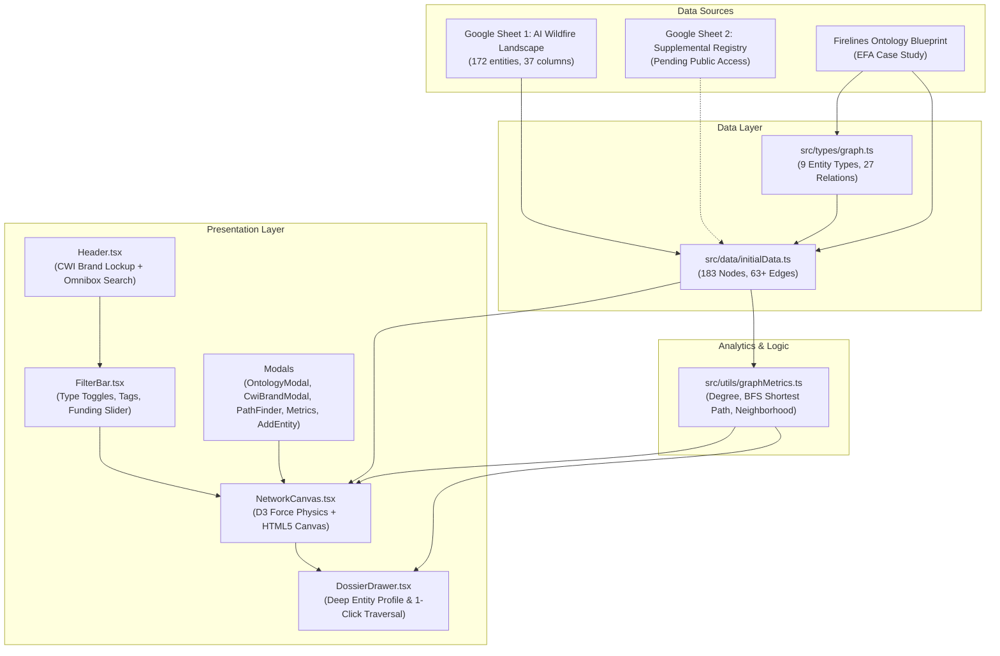

# AI Agent Memory & Context Handoff
## Project: GraphEmber — Climate & Wildfire Intelligence Knowledge Graph Platform
**Location**: `c:\Users\David\Projects\GraphEmber\ai-memory`  
**Mirror Location**: `c:\Users\David\Projects\AI-Memory\GraphEmber`  
**Last Updated**: October 16, 2026  
**Primary Objective**: Map, model, and visualize the global environmental intelligence ecosystem across institutions, collaboratives, programs, products, grants, research, meetings, and key thematic topics, anchored in the Climate & Wildfire Institute (CWI) brand identity, the Firelines Graph Ontology, and the Google.org AI Wildfire Landscape dataset.

---

> [!CAUTION]
> ### SACROSANCT RULES FOR INCOMING AGENTS
> 1. **PRESERVE ONTOLOGY INTEGRITY**: Any modification to [`src/types/graph.ts`](file:///c:/Users/David/Projects/GraphEmber/src/types/graph.ts) must conform to the **Firelines Ontology Blueprint** ($\text{Organization} \xrightarrow[\text{how}]{\text{PartnersIn}} \text{Consortium} \xrightarrow{\text{HasProject}} \text{Product} \xrightarrow[\text{modality}]{\text{HasTopic}} \text{Topic}$). Edges must preserve semantic attributes (`how`, `modality`, `properties`).
> 2. **MAINTAIN ZERO LINT / BUILD ERRORS**: Every change must compile cleanly with `npm run build` (`tsc -b`) and pass `npx oxlint`. No broken types or dangling imports.
> 3. **PROTECT CWI BRANDING**: The Climate & Wildfire Institute 501(c)(3) branding, logos ([`public/cwi-logo.png`](file:///c:/Users/David/Projects/GraphEmber/public/cwi-logo.png), [`public/cwi-horizontal-logo.jpg`](file:///c:/Users/David/Projects/GraphEmber/public/cwi-horizontal-logo.jpg)), and color tokens (`--color-cwi-gold`, `--color-cwi-amber`, `--color-cwi-flame`, `--cwi-gradient-flame`) are the core institutional design standard. Do not revert to generic palettes.
> 4. **CONTINUOUS MEMORY UPDATES**: Whenever you discover new domain relationships, ingest new spreadsheets, or enhance algorithms, **YOU MUST UPDATE OR EXTEND THIS `ai-memory/` DIRECTORY**.

---

## Instructions for Incoming Development Agents

> [!IMPORTANT]
> **READ THIS REPOSITORY BEFORE MODIFYING CODE.**
> All ongoing context, mathematical algorithms, data schemas, spreadsheet ingestion protocols, links, methods, and forensic session histories are permanently archived in this `ai-memory/` directory.

### Memory Catalog

1. **[`01_DOMAIN_ONTOLOGY_AND_DATA_MODEL.md`](file:///c:/Users/David/Projects/GraphEmber/ai-memory/01_DOMAIN_ONTOLOGY_AND_DATA_MODEL.md)**
   * **The Firelines Graph Database Ontology**: Complete specification of the typed, directed, attributed property graph.
   * **The 9 First-Class Entity Types**: `person`, `institution`, `collaborative`, `program`, `product`, `grant`, `research`, `meeting`, and `topic`.
   * **27 Relation Types**: Definitions and valid source-target pairs (`PARTNERS_IN`, `HAS_PROJECT`, `HAS_TOPIC`, `SUBSIDIARY_OF`, `INVOLVED_IN`, `FUNDS`, `DEVELOPS`, etc.).
   * **Edge Attributes**: First-class role metadata (`how`, `modality`, `properties`).
   * **Ground-Truth EFA & FireSat Case Study**: Earth Fire Alliance, Google.org, Moore Foundation, Minderoo Foundation, Muon Space, EDF, and CWI.

2. **[`02_METHODS_ALGORITHMS_AND_TECHNICAL_ARCHITECTURE.md`](file:///c:/Users/David/Projects/GraphEmber/ai-memory/02_METHODS_ALGORITHMS_AND_TECHNICAL_ARCHITECTURE.md)**
   * **Graph Theory & Analytics**: Degree Centrality, In-Degree, Out-Degree, and directed flow metrics.
   * **Shortest Path Finder Algorithm**: Breadth-First Search (BFS) graph traversal with parent map edge reconstruction.
   * **Neighborhood Isolation Algorithms**: 1-hop and 2-hop neighborhood expansion and canvas dimming.
   * **D3 Physics Engine**: Simulation parameters (`alphaDecay`, `velocityDecay`, `forceLink`, `forceManyBody`, `forceCollide`).
   * **Canvas 60fps Rendering Engine**: High-DPI (Retina) scaling, d3-zoom 2D matrix transformation, quadratic bezier curved edges, text halos, and bounding-box hit detection.
   * **React 19 + TypeScript Architecture**: Component hierarchy, state hooks, and filter pipelines.

3. **[`03_DATA_PIPELINE_AND_SHEETS_INGESTION.md`](file:///c:/Users/David/Projects/GraphEmber/ai-memory/03_DATA_PIPELINE_AND_SHEETS_INGESTION.md)**
   * **Sheet 1 Ingestion**: Ingestion of all 172 landscape entities from the Google.org AI Wildfire Landscape Google Sheet (`1bw2XNGHbQXSmz2UCveUSq8TLgGJGXpnUIrjVmOCIOvE`).
   * **Sheet 2 Troubleshooting & Protocol**: Forensic analysis of the private Google Sheet (`16byGxXobEVl8YKtmImO7UMR-95ZsmLYFjY7qjSyY_LY`), curl export formats, 302 login redirects, and the step-by-step ingestion method once sharing permissions are set to public.
   * **Tabular-to-Graph ETL**: Deduplication rules, entity slugification, role class mapping, and topic synthesis.
   * **JSON Import/Export Contract**: Schema for `NetworkDataset`.

4. **[`04_BRAND_IDENTITY_AND_DESIGN_SYSTEM.md`](file:///c:/Users/David/Projects/GraphEmber/ai-memory/04_BRAND_IDENTITY_AND_DESIGN_SYSTEM.md)**
   * **Climate & Wildfire Institute (CWI)**: Institutional mission as an independent 501(c)(3) boundary organization.
   * **Core Initiatives**: Resilient Home Fund, Firelines, Applied Policy, and Wildfire Data Commons.
   * **Color System & Tokens**: HSL tailored palette, ember glow, dark slate canvas (`#07090e`), and glassmorphism tokens.
   * **Typography**: Poppins, Nunito, Outfit, Inter, and JetBrains Mono pairings.
   * **Logo Assets & Visual Elements**: Faceted flame prism mark, horizontal lockup, badges, and CSS animations.

5. **[`05_MASTER_LINK_CATALOG_AND_RESOURCES.md`](file:///c:/Users/David/Projects/GraphEmber/ai-memory/05_MASTER_LINK_CATALOG_AND_RESOURCES.md)**
   * **Comprehensive Indexed Directory**: Every single URL, portal, spreadsheet, research initiative, agency website, and tool referenced across all development sessions.
   * Categorized by Institutional Portals, Funders, Systems & Models, Government & Academia, Data Repositories, and Code Repositories.

6. **[`06_SESSION_CHRONICLES_AND_DECISION_LOG.md`](file:///c:/Users/David/Projects/GraphEmber/ai-memory/06_SESSION_CHRONICLES_AND_DECISION_LOG.md)**
   * **Forensic Timeline**: Chronological record of all 4 sessions on October 16, 2026 (`3ac02762`, `2d62c719`, `b25c9653`, `0d95eeb9`).
   * **Architectural Decision Records (ADRs)**: Technical decisions, trade-offs, and design rationales made during system evolution.

---

## Quick Reference System Architecture

